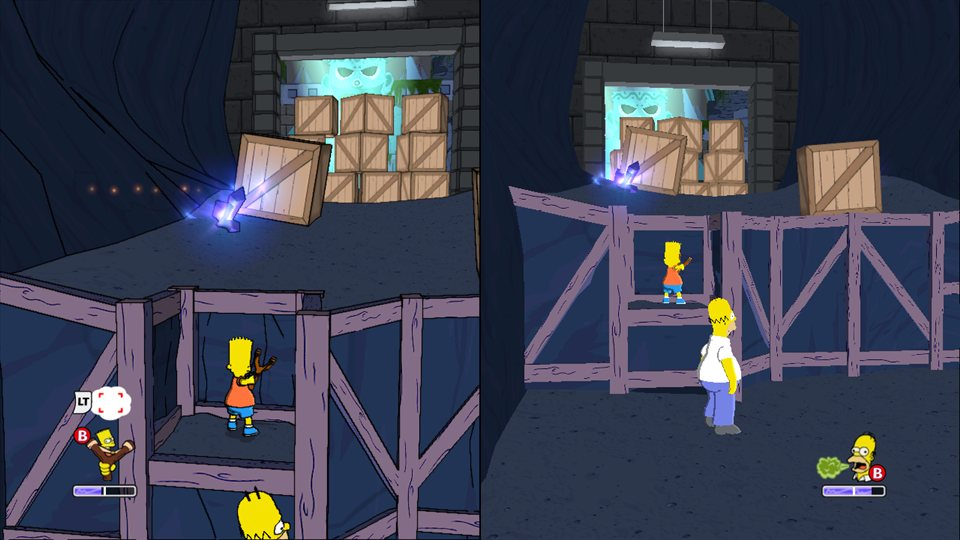
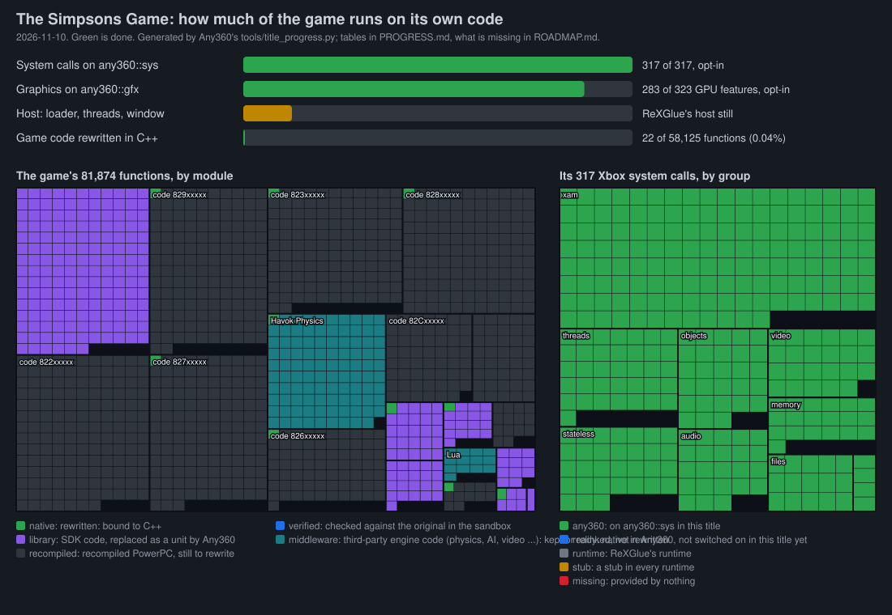

# The Simpsons Game Rewrite

<p align="center">

</p>

**The Simpsons Game (Xbox 360, 2007), statically recompiled to native PC code and rewritten, step by step, onto [Any360](https://github.com/GaetanVigner/Any360).** It follows [YesterMester's port](https://github.com/YesterMester/TheSimpsonsGameRecomp) (v0.0.6.5, for Linux, Steam Deck and Windows) and takes it one step further: off the Xbox 360 emulation layers, until nothing of the console or of the ReXGlue runtime is left under the game.

**No game data and no game binaries are here.** You need your own copy of the Xbox 360 game; the game runs only with data installed from an ISO of your own disc.

## Where the rewrite stands

<!-- progress:begin -->
[](docs/progress/PROGRESS.md)

| | Where it stands |
|---|---|
| **System calls** | 317 of 317 on `any360::sys` (opt-in) |
| **Graphics** | `any360::gfx`, a Vulkan renderer handling 283 of 323 Xbox 360 GPU features (opt-in) |
| **Host** | ReXGlue's loader, threads and window; Any360's own host is not started |
| **Game code** | 23 of 58,125 functions rewritten in C++ (0.04%) |

Updated 2026-11-16. Every system call, module and rewritten function: [PROGRESS.md](docs/progress/PROGRESS.md). What is missing, step by step: [ROADMAP.md](docs/progress/ROADMAP.md). Function by function: [functions.csv](docs/progress/functions.csv).
<!-- progress:end -->

## What this is

The game's PowerPC executable is translated ahead of time into C++ ([ReXGlue](https://github.com/rexglue/rexglue-sdk)) and compiled for the PC, so the game's own code runs directly on the processor. Under it, something has to stand in for the console: its system calls, its GPU, the libraries the game was linked with. In a recompilation port that is an emulation layer. Here it is replaced piece by piece by native code, and the game's own functions are then rewritten in C++, each proven against the original, until the result is an ordinary portable program.

| Step | What runs under the game | State here |
|---|---|---|
| Recompiled | ReXGlue's runtime: emulated kernel, emulated GPU | the whole game plays, as upstream's port does |
| System calls | `any360::sys`, native implementations of the Xbox 360 system calls | all eight groups, opt-in on `main` (built with `SIMPSONS_ANY360_DIR`): `--any360_sys_groups=stateless,files,objects,threads,memory,xam,input,audio`; levels, saves, sound and gamepad checked in game |
| Graphics | `any360::gfx`, a Vulkan renderer fed by the game's own draw commands | opt-in on `main` (built with `SIMPSONS_ANY360_DIR`): `--any360_gpu=true`; 60 FPS in gameplay and 30 on menus and loading screens (the game's own pacing), as with the runtime's GPU |
| Library functions | `any360::xdk`, host versions of the XDK functions linked into the game | five memory functions (`memcpy`, its forward copy, `memmove`, `memset`, the vector copy), compared with the game's own code on 83 M calls in a level; the vector copy alone is called 170,000 times a second |
| Game code | C++ rewritten function by function, checked against the recompiled original | the first functions replaced by host code (the count is in the table above) |

Every system call, module and function, and what is missing in order: [docs/progress/PROGRESS.md](docs/progress/PROGRESS.md), [docs/progress/ROADMAP.md](docs/progress/ROADMAP.md).

## Any360

[Any360](https://github.com/GaetanVigner/Any360) is the toolkit this rewrite is built on: a system layer, a renderer and a library of native functions written once for every Xbox 360 game, with the tools that measure how much of a game runs on them. A game is a test bench for it, not its target: what one game needed is there for the next, and each piece is checked in the games before it is trusted.

- **`any360::sys`**: the console's system calls (files, threads, memory, profile and saves, audio with a native XMA decoder, input), each tested against the reference runtime.
- **`any360::gfx`**: the Xbox 360 GPU's command stream drawn by a Vulkan renderer (resolution scale, host anti-aliasing, frame rates above the console's).
- **`any360::xdk`**: the functions games link from the XDK (the C runtime's `memcpy`, `memmove`, `memset`, the vector copy), each with a reference model, unit tests and a benchmark, and compared with the game's own code on every call in game before it is bound.

The games rewritten on it, each with the same report of where it stands:

- [Crackdown](https://github.com/GaetanVigner/CrackdownRewrite)
- [The Simpsons Game](https://github.com/GaetanVigner/TheSimpsonsGameRewrite) (this repository)
- [Test Drive Unlimited](https://github.com/GaetanVigner/TDURewrite)
- [Call of Duty: Black Ops](https://github.com/GaetanVigner/CoDBoRewrite)
- [Mirror's Edge](https://github.com/GaetanVigner/MirrorsEdgeRewrite)

How it is designed and how far it is: [the project page](https://github.com/GaetanVigner/Any360), [its progress](https://github.com/GaetanVigner/Any360/blob/main/docs/progress.svg), [the rule native functions follow](https://github.com/GaetanVigner/Any360/blob/main/docs/NATIVE_FUNCTIONS.md).

## Running it on Any360

Any360 is optional here: without it the build is upstream's. Build with an Any360 checkout, then launch with both bindings:

```
cmake --preset win-amd64-relwithdebinfo -DSIMPSONS_ANY360_DIR=<an Any360 checkout>
simpsons.exe --any360_gpu=true --any360_sys_groups=stateless,files,objects,threads,memory,xam,input,audio
```

The whole game plays this way: levels, saves, sound, gamepad, split-screen co-op. The library functions run on `any360::xdk` by default in such a build (`--any360_xdk_natives=false` runs the game's own; `--any360_xdk_verify=true` runs both on every call and compares them).

`--any360_fps_overlay=true` draws Any360's frame counter over the top-left corner of the picture (frames per second, frame time and the slowest of the last half second, median and 10% / 1% lows of the last 512 frames, GPU time a frame): the same for every game on `any360::gfx`, off by default and free when off. The Any360Launcher's Video options switch it on.

## Building

As upstream's port, on Linux and Windows: [docs/LEGACY_README.md](docs/LEGACY_README.md) has upstream's page (requirements, installation from your ISO, configuration, building from source, known issues).

## Credits

- *The Simpsons Game* by EA Redwood Shores, published by Electronic Arts (2007).
- [YesterMester/TheSimpsonsGameRecomp](https://github.com/YesterMester/TheSimpsonsGameRecomp), the port this repository follows, and its contributors (tronuo, frankyfife, Gabry179, awemancba, anasalialamgir; their work is listed in [docs/LEGACY_README.md](docs/LEGACY_README.md)).
- [Xenia](https://xenia.jp), the Xbox 360 emulator research project the runtime is built on; the ReXGlue SDK by Tom Clay; [XenonRecomp](https://github.com/hedge-dev/XenonRecomp) by hedge-dev and contributors.
- [Any360](https://github.com/GaetanVigner/Any360) for the system layer, the renderer and the native library functions.

## Legal and licence

*The Simpsons Game* is © 2007 Electronic Arts Inc. *The Simpsons* and all related characters and trademarks belong to their respective owners. An unofficial, non-commercial fan project, not affiliated with, endorsed by or sponsored by Electronic Arts, Fox, Microsoft or any other rights holder. The repository contains no game assets; the code in `simpsons/generated` is produced by recompiling the game's executable code and does not contain the game's data.

The project's own code is under the [GNU General Public License v3.0](LICENSE). The ReXGlue SDK in `tools/rexglue-sdk` is under the BSD 3-Clause License, as is the Xenia code it derives from; XenonRecomp in `tools/XenonRecomp` is under the MIT License.

AI tools (Claude Code) are used for code analysis, development, testing and documentation of this rewrite; changes are directed and tested by the maintainer.
