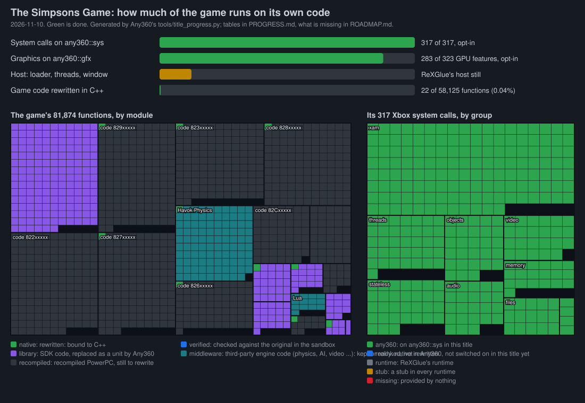

# The Simpsons Game: rewrite progress

Generated on 2026-11-16 by [Any360](https://github.com/GaetanVigner/Any360)'s `tools/title_progress.py`. What is still missing, step by step: [ROADMAP.md](ROADMAP.md). Every function: [functions.csv](functions.csv). Counts: [progress.json](progress.json).

## Where it stands

| Axis | Done | Of | Share | Notes |
|---|---|---|---|---|
| System calls on `any360::sys` | 317 | 317 | 100% | all eight groups, opt-in on `main` (built with `SIMPSONS_ANY360_DIR`): `--any360_sys_groups=stateless,files,objects,threads,memory,xam,input,audio`; levels, saves, sound and gamepad checked in game |
| Graphics on `any360::gfx` (GPU features Any360 handles) | 283 | 323 | 88% | opt-in on `main` (built with `SIMPSONS_ANY360_DIR`): `--any360_gpu=true`; 60 FPS in gameplay and 30 on menus and loading screens (the game's own pacing), as with the runtime's GPU |
| Host (XEX loader, address space, threads, window, input, audio output) | 0 | 2 | 0% | ReXGlue's host runs the title; Any360 steps 13 and 14 |
| Game functions rewritten in C++ | 23 | 58,125 | 0.04% | 0 more verified against the original in the sandbox |
| Library functions (SDK, middleware) replaced | 20 | 16,228 | 0.1% | replaced as units, not decompiled |
| Middleware functions (third-party physics, AI, scripting, video) | - | 7,521 | - | kept recompiled or relinked from the vendor's library, not rewritten |
| Instructions of rewritten functions | 2,484 | 2,938,307 | 0.08% | PowerPC instructions of the original |

## System calls

The 317 kernel and XAM functions the title imports, by the group a title switches to `any360::sys` at once. **any360**: on any360::sys in this title. **ready**: native in Any360, not switched on in this title yet. **runtime**: ReXGlue's runtime. **stub**: a stub in every runtime. **missing**: provided by nothing.

| Group | any360 | ready | runtime | stub | missing | Total |
|---|---|---|---|---|---|---|
| stateless | 31 | 0 | 0 | 0 | 0 | 31 |
| files | 15 | 0 | 0 | 0 | 0 | 15 |
| objects | 28 | 0 | 0 | 0 | 0 | 28 |
| threads | 36 | 0 | 0 | 0 | 0 | 36 |
| memory | 19 | 0 | 0 | 0 | 0 | 19 |
| xam | 138 | 0 | 0 | 0 | 0 | 138 |
| input | 4 | 0 | 0 | 0 | 0 | 4 |
| audio | 23 | 0 | 0 | 0 | 0 | 23 |
| video | 23 | 0 | 0 | 0 | 0 | 23 |

Every call

| Group | Library | Function | State |
|---|---|---|---|
| stateless | xboxkrnl | `DbgBreakPoint` | any360 |
| stateless | xboxkrnl | `DbgPrint` | any360 |
| stateless | xboxkrnl | `ExGetXConfigSetting` | any360 |
| stateless | xboxkrnl | `KeBugCheck` | any360 |
| stateless | xboxkrnl | `KeBugCheckEx` | any360 |
| stateless | xboxkrnl | `KeEnableFpuExceptions` | any360 |
| stateless | xboxkrnl | `RtlCaptureContext` | any360 |
| stateless | xboxkrnl | `RtlCompareMemory` | any360 |
| stateless | xboxkrnl | `RtlCompareMemoryUlong` | any360 |
| stateless | xboxkrnl | `RtlFillMemoryUlong` | any360 |
| stateless | xboxkrnl | `RtlImageXexHeaderField` | any360 |
| stateless | xboxkrnl | `RtlInitAnsiString` | any360 |
| stateless | xboxkrnl | `RtlMultiByteToUnicodeN` | any360 |
| stateless | xboxkrnl | `RtlNtStatusToDosError` | any360 |
| stateless | xboxkrnl | `RtlRaiseException` | any360 |
| stateless | xboxkrnl | `RtlTimeFieldsToTime` | any360 |
| stateless | xboxkrnl | `RtlTimeToTimeFields` | any360 |
| stateless | xboxkrnl | `RtlUnicodeToMultiByteN` | any360 |
| stateless | xboxkrnl | `RtlUnwind` | any360 |
| stateless | xam | `XGetAVPack` | any360 |
| stateless | xam | `XGetGameRegion` | any360 |
| stateless | xam | `XGetLanguage` | any360 |
| stateless | xam | `XamGetExecutionId` | any360 |
| stateless | xam | `XamGetSystemVersion` | any360 |
| stateless | xam | `XamVoiceClose` | any360 |
| stateless | xam | `XamVoiceCreate` | any360 |
| stateless | xam | `XamVoiceHeadsetPresent` | any360 |
| stateless | xam | `XamVoiceSubmitPacket` | any360 |
| stateless | xboxkrnl | `__C_specific_handler` | any360 |
| stateless | xboxkrnl | `_vsnprintf` | any360 |
| stateless | xboxkrnl | `sprintf` | any360 |
| files | xboxkrnl | `FscGetCacheElementCount` | any360 |
| files | xboxkrnl | `FscSetCacheElementCount` | any360 |
| files | xboxkrnl | `NtCreateFile` | any360 |
| files | xboxkrnl | `NtFlushBuffersFile` | any360 |
| files | xboxkrnl | `NtOpenFile` | any360 |
| files | xboxkrnl | `NtQueryDirectoryFile` | any360 |
| files | xboxkrnl | `NtQueryFullAttributesFile` | any360 |
| files | xboxkrnl | `NtQueryInformationFile` | any360 |
| files | xboxkrnl | `NtQueryVolumeInformationFile` | any360 |
| files | xboxkrnl | `NtReadFile` | any360 |
| files | xboxkrnl | `NtReadFileScatter` | any360 |
| files | xboxkrnl | `NtSetInformationFile` | any360 |
| files | xboxkrnl | `NtWriteFile` | any360 |
| files | xboxkrnl | `ObCreateSymbolicLink` | any360 |
| files | xboxkrnl | `ObDeleteSymbolicLink` | any360 |
| objects | xboxkrnl | `KeInitializeSemaphore` | any360 |
| objects | xboxkrnl | `KePulseEvent` | any360 |
| objects | xboxkrnl | `KeReleaseSemaphore` | any360 |
| objects | xboxkrnl | `KeResetEvent` | any360 |
| objects | xboxkrnl | `KeSetEvent` | any360 |
| objects | xboxkrnl | `KeWaitForMultipleObjects` | any360 |
| objects | xboxkrnl | `KeWaitForSingleObject` | any360 |
| objects | xboxkrnl | `NtCancelTimer` | any360 |
| objects | xboxkrnl | `NtClearEvent` | any360 |
| objects | xboxkrnl | `NtClose` | any360 |
| objects | xboxkrnl | `NtCreateEvent` | any360 |
| objects | xboxkrnl | `NtCreateMutant` | any360 |
| objects | xboxkrnl | `NtCreateSemaphore` | any360 |
| objects | xboxkrnl | `NtCreateTimer` | any360 |
| objects | xboxkrnl | `NtDuplicateObject` | any360 |
| objects | xboxkrnl | `NtPulseEvent` | any360 |
| objects | xboxkrnl | `NtReleaseMutant` | any360 |
| objects | xboxkrnl | `NtReleaseSemaphore` | any360 |
| objects | xboxkrnl | `NtSetEvent` | any360 |
| objects | xboxkrnl | `NtSetTimerEx` | any360 |
| objects | xboxkrnl | `NtSignalAndWaitForSingleObjectEx` | any360 |
| objects | xboxkrnl | `NtWaitForMultipleObjectsEx` | any360 |
| objects | xboxkrnl | `NtWaitForSingleObjectEx` | any360 |
| objects | xboxkrnl | `ObDereferenceObject` | any360 |
| objects | xboxkrnl | `ObLookupThreadByThreadId` | any360 |
| objects | xboxkrnl | `ObOpenObjectByName` | any360 |
| objects | xboxkrnl | `ObOpenObjectByPointer` | any360 |
| objects | xboxkrnl | `ObReferenceObjectByHandle` | any360 |
| threads | xboxkrnl | `ExCreateThread` | any360 |
| threads | xboxkrnl | `ExTerminateThread` | any360 |
| threads | xboxkrnl | `HalReturnToFirmware` | any360 |
| threads | xboxkrnl | `KeAcquireSpinLockAtRaisedIrql` | any360 |
| threads | xboxkrnl | `KeDelayExecutionThread` | any360 |
| threads | xboxkrnl | `KeEnterCriticalRegion` | any360 |
| threads | xboxkrnl | `KeGetCurrentProcessType` | any360 |
| threads | xboxkrnl | `KeLeaveCriticalRegion` | any360 |
| threads | xboxkrnl | `KeQueryBasePriorityThread` | any360 |
| threads | xboxkrnl | `KeQueryPerformanceFrequency` | any360 |
| threads | xboxkrnl | `KeQuerySystemTime` | any360 |
| threads | xboxkrnl | `KeRaiseIrqlToDpcLevel` | any360 |
| threads | xboxkrnl | `KeReleaseSpinLockFromRaisedIrql` | any360 |
| threads | xboxkrnl | `KeResumeThread` | any360 |
| threads | xboxkrnl | `KeSetAffinityThread` | any360 |
| threads | xboxkrnl | `KeSetBasePriorityThread` | any360 |
| threads | xboxkrnl | `KeSetDisableBoostThread` | any360 |
| threads | xboxkrnl | `KeTlsAlloc` | any360 |
| threads | xboxkrnl | `KeTlsFree` | any360 |
| threads | xboxkrnl | `KeTlsGetValue` | any360 |
| threads | xboxkrnl | `KeTlsSetValue` | any360 |
| threads | xboxkrnl | `KeTryToAcquireSpinLockAtRaisedIrql` | any360 |
| threads | xboxkrnl | `KfAcquireSpinLock` | any360 |
| threads | xboxkrnl | `KfLowerIrql` | any360 |
| threads | xboxkrnl | `KfReleaseSpinLock` | any360 |
| threads | xboxkrnl | `KiApcNormalRoutineNop` | any360 |
| threads | xboxkrnl | `NtQueueApcThread` | any360 |
| threads | xboxkrnl | `NtResumeThread` | any360 |
| threads | xboxkrnl | `NtSuspendThread` | any360 |
| threads | xboxkrnl | `NtYieldExecution` | any360 |
| threads | xboxkrnl | `RtlEnterCriticalSection` | any360 |
| threads | xboxkrnl | `RtlInitializeCriticalSection` | any360 |
| threads | xboxkrnl | `RtlInitializeCriticalSectionAndSpinCount` | any360 |
| threads | xboxkrnl | `RtlLeaveCriticalSection` | any360 |
| threads | xboxkrnl | `RtlTryEnterCriticalSection` | any360 |
| threads | xboxkrnl | `XexUnloadImageAndExitThread` | any360 |
| memory | xboxkrnl | `ExAllocatePool` | any360 |
| memory | xboxkrnl | `ExAllocatePoolWithTag` | any360 |
| memory | xboxkrnl | `ExFreePool` | any360 |
| memory | xboxkrnl | `KeLockL2` | any360 |
| memory | xboxkrnl | `KeUnlockL2` | any360 |
| memory | xboxkrnl | `MmAllocatePhysicalMemory` | any360 |
| memory | xboxkrnl | `MmAllocatePhysicalMemoryEx` | any360 |
| memory | xboxkrnl | `MmFreePhysicalMemory` | any360 |
| memory | xboxkrnl | `MmGetPhysicalAddress` | any360 |
| memory | xboxkrnl | `MmQueryAddressProtect` | any360 |
| memory | xboxkrnl | `MmQueryAllocationSize` | any360 |
| memory | xboxkrnl | `MmQueryStatistics` | any360 |
| memory | xboxkrnl | `MmSetAddressProtect` | any360 |
| memory | xboxkrnl | `NtAllocateVirtualMemory` | any360 |
| memory | xboxkrnl | `NtFreeVirtualMemory` | any360 |
| memory | xboxkrnl | `NtProtectVirtualMemory` | any360 |
| memory | xboxkrnl | `NtQueryVirtualMemory` | any360 |
| memory | xam | `XamAlloc` | any360 |
| memory | xam | `XamFree` | any360 |
| xam | xboxkrnl | `ExRegisterTitleTerminateNotification` | any360 |
| xam | xam | `NetDll_WSACancelOverlappedIO` | any360 |
| xam | xam | `NetDll_WSACleanup` | any360 |
| xam | xam | `NetDll_WSACloseEvent` | any360 |
| xam | xam | `NetDll_WSACreateEvent` | any360 |
| xam | xam | `NetDll_WSAEventSelect` | any360 |
| xam | xam | `NetDll_WSAGetLastError` | any360 |
| xam | xam | `NetDll_WSAGetOverlappedResult` | any360 |
| xam | xam | `NetDll_WSARecv` | any360 |
| xam | xam | `NetDll_WSARecvFrom` | any360 |
| xam | xam | `NetDll_WSAResetEvent` | any360 |
| xam | xam | `NetDll_WSASend` | any360 |
| xam | xam | `NetDll_WSASendTo` | any360 |
| xam | xam | `NetDll_WSASetEvent` | any360 |
| xam | xam | `NetDll_WSASetLastError` | any360 |
| xam | xam | `NetDll_WSAStartup` | any360 |
| xam | xam | `NetDll_WSAWaitForMultipleEvents` | any360 |
| xam | xam | `NetDll_XNetCleanup` | any360 |
| xam | xam | `NetDll_XNetConnect` | any360 |
| xam | xam | `NetDll_XNetCreateKey` | any360 |
| xam | xam | `NetDll_XNetDnsLookup` | any360 |
| xam | xam | `NetDll_XNetDnsRelease` | any360 |
| xam | xam | `NetDll_XNetGetBroadcastVersionStatus` | any360 |
| xam | xam | `NetDll_XNetGetConnectStatus` | any360 |
| xam | xam | `NetDll_XNetGetDebugXnAddr` | any360 |
| xam | xam | `NetDll_XNetGetEthernetLinkStatus` | any360 |
| xam | xam | `NetDll_XNetGetOpt` | any360 |
| xam | xam | `NetDll_XNetGetTitleXnAddr` | any360 |
| xam | xam | `NetDll_XNetInAddrToServer` | any360 |
| xam | xam | `NetDll_XNetInAddrToString` | any360 |
| xam | xam | `NetDll_XNetInAddrToXnAddr` | any360 |
| xam | xam | `NetDll_XNetQosGetListenStats` | any360 |
| xam | xam | `NetDll_XNetQosListen` | any360 |
| xam | xam | `NetDll_XNetQosLookup` | any360 |
| xam | xam | `NetDll_XNetQosRelease` | any360 |
| xam | xam | `NetDll_XNetQosServiceLookup` | any360 |
| xam | xam | `NetDll_XNetRandom` | any360 |
| xam | xam | `NetDll_XNetRegisterKey` | any360 |
| xam | xam | `NetDll_XNetServerToInAddr` | any360 |
| xam | xam | `NetDll_XNetSetOpt` | any360 |
| xam | xam | `NetDll_XNetStartup` | any360 |
| xam | xam | `NetDll_XNetTsAddrToInAddr` | any360 |
| xam | xam | `NetDll_XNetUnregisterInAddr` | any360 |
| xam | xam | `NetDll_XNetUnregisterKey` | any360 |
| xam | xam | `NetDll_XNetXnAddrToInAddr` | any360 |
| xam | xam | `NetDll_XNetXnAddrToMachineId` | any360 |
| xam | xam | `NetDll___WSAFDIsSet` | any360 |
| xam | xam | `NetDll_accept` | any360 |
| xam | xam | `NetDll_bind` | any360 |
| xam | xam | `NetDll_closesocket` | any360 |
| xam | xam | `NetDll_connect` | any360 |
| xam | xam | `NetDll_getpeername` | any360 |
| xam | xam | `NetDll_getsockname` | any360 |
| xam | xam | `NetDll_getsockopt` | any360 |
| xam | xam | `NetDll_inet_addr` | any360 |
| xam | xam | `NetDll_ioctlsocket` | any360 |
| xam | xam | `NetDll_listen` | any360 |
| xam | xam | `NetDll_recv` | any360 |
| xam | xam | `NetDll_recvfrom` | any360 |
| xam | xam | `NetDll_select` | any360 |
| xam | xam | `NetDll_send` | any360 |
| xam | xam | `NetDll_sendto` | any360 |
| xam | xam | `NetDll_setsockopt` | any360 |
| xam | xam | `NetDll_shutdown` | any360 |
| xam | xam | `NetDll_socket` | any360 |
| xam | xam | `Refresh` | any360 |
| xam | xam | `XMsgCancelIORequest` | any360 |
| xam | xam | `XMsgInProcessCall` | any360 |
| xam | xam | `XMsgStartIORequest` | any360 |
| xam | xam | `XMsgStartIORequestEx` | any360 |
| xam | xam | `XMsgSystemProcessCall` | any360 |
| xam | xam | `XNetLogonGetMachineID` | any360 |
| xam | xam | `XNetLogonGetTitleID` | any360 |
| xam | xam | `XNotifyGetNext` | any360 |
| xam | xam | `XamContentClose` | any360 |
| xam | xam | `XamContentCreateDeviceEnumerator` | any360 |
| xam | xam | `XamContentCreateEnumerator` | any360 |
| xam | xam | `XamContentCreateEx` | any360 |
| xam | xam | `XamContentDelete` | any360 |
| xam | xam | `XamContentFlush` | any360 |
| xam | xam | `XamContentGetCreator` | any360 |
| xam | xam | `XamContentGetDeviceData` | any360 |
| xam | xam | `XamContentGetDeviceName` | any360 |
| xam | xam | `XamContentGetDeviceState` | any360 |
| xam | xam | `XamContentGetLicenseMask` | any360 |
| xam | xam | `XamContentGetThumbnail` | any360 |
| xam | xam | `XamContentInstall` | any360 |
| xam | xam | `XamContentLaunchImage` | any360 |
| xam | xam | `XamContentResolve` | any360 |
| xam | xam | `XamContentSetThumbnail` | any360 |
| xam | xam | `XamCreateEnumeratorHandle` | any360 |
| xam | xam | `XamEnumerate` | any360 |
| xam | xam | `XamGetPrivateEnumStructureFromHandle` | any360 |
| xam | xam | `XamLoaderLaunchTitle` | any360 |
| xam | xam | `XamLoaderTerminateTitle` | any360 |
| xam | xam | `XamNotifyCreateListener` | any360 |
| xam | xam | `XamParseGamerTileKey` | any360 |
| xam | xam | `XamReadTileToTexture` | any360 |
| xam | xam | `XamSessionCreateHandle` | any360 |
| xam | xam | `XamSessionRefObjByHandle` | any360 |
| xam | xam | `XamShowAchievementsUI` | any360 |
| xam | xam | `XamShowDeviceSelectorUI` | any360 |
| xam | xam | `XamShowDirtyDiscErrorUI` | any360 |
| xam | xam | `XamShowFriendRequestUI` | any360 |
| xam | xam | `XamShowFriendsUI` | any360 |
| xam | xam | `XamShowGameInviteUI` | any360 |
| xam | xam | `XamShowGamerCardUIForXUID` | any360 |
| xam | xam | `XamShowKeyboardUI` | any360 |
| xam | xam | `XamShowMarketplaceUI` | any360 |
| xam | xam | `XamShowMessageBoxUI` | any360 |
| xam | xam | `XamShowMessageBoxUIEx` | any360 |
| xam | xam | `XamShowMessageComposeUI` | any360 |
| xam | xam | `XamShowMessagesUI` | any360 |
| xam | xam | `XamShowPlayerReviewUI` | any360 |
| xam | xam | `XamShowPlayersUI` | any360 |
| xam | xam | `XamShowQuickChatUI` | any360 |
| xam | xam | `XamShowSigninUI` | any360 |
| xam | xam | `XamShowSigninUIp` | any360 |
| xam | xam | `XamShowVoiceMailUI` | any360 |
| xam | xam | `XamUserAreUsersFriends` | any360 |
| xam | xam | `XamUserCheckPrivilege` | any360 |
| xam | xam | `XamUserCreateAchievementEnumerator` | any360 |
| xam | xam | `XamUserCreateStatsEnumerator` | any360 |
| xam | xam | `XamUserGetMembershipTierFromXUID` | any360 |
| xam | xam | `XamUserGetName` | any360 |
| xam | xam | `XamUserGetOnlineCountryFromXUID` | any360 |
| xam | xam | `XamUserGetSigninInfo` | any360 |
| xam | xam | `XamUserGetSigninState` | any360 |
| xam | xam | `XamUserGetXUID` | any360 |
| xam | xam | `XamUserReadProfileSettings` | any360 |
| xam | xam | `XamUserWriteProfileSettings` | any360 |
| xam | xam | `XamWriteGamerTile` | any360 |
| xam | xboxkrnl | `XexCheckExecutablePrivilege` | any360 |
| xam | xboxkrnl | `XexGetModuleHandle` | any360 |
| xam | xboxkrnl | `XexGetModuleSection` | any360 |
| xam | xboxkrnl | `XexGetProcedureAddress` | any360 |
| xam | xboxkrnl | `XexLoadImage` | any360 |
| xam | xboxkrnl | `XexUnloadImage` | any360 |
| input | xam | `XamInputGetCapabilities` | any360 |
| input | xam | `XamInputGetKeystrokeEx` | any360 |
| input | xam | `XamInputGetState` | any360 |
| input | xam | `XamInputSetState` | any360 |
| audio | xboxkrnl | `XAudioGetSpeakerConfig` | any360 |
| audio | xboxkrnl | `XAudioGetVoiceCategoryVolume` | any360 |
| audio | xboxkrnl | `XAudioGetVoiceCategoryVolumeChangeMask` | any360 |
| audio | xboxkrnl | `XAudioQueryDriverPerformance` | any360 |
| audio | xboxkrnl | `XAudioRegisterRenderDriverClient` | any360 |
| audio | xboxkrnl | `XAudioSubmitRenderDriverFrame` | any360 |
| audio | xboxkrnl | `XAudioUnregisterRenderDriverClient` | any360 |
| audio | xboxkrnl | `XMACreateContext` | any360 |
| audio | xboxkrnl | `XMADisableContext` | any360 |
| audio | xboxkrnl | `XMAEnableContext` | any360 |
| audio | xboxkrnl | `XMAGetOutputBufferReadOffset` | any360 |
| audio | xboxkrnl | `XMAGetOutputBufferWriteOffset` | any360 |
| audio | xboxkrnl | `XMAInitializeContext` | any360 |
| audio | xboxkrnl | `XMAIsInputBuffer0Valid` | any360 |
| audio | xboxkrnl | `XMAIsInputBuffer1Valid` | any360 |
| audio | xboxkrnl | `XMAIsOutputBufferValid` | any360 |
| audio | xboxkrnl | `XMAReleaseContext` | any360 |
| audio | xboxkrnl | `XMASetInputBuffer0` | any360 |
| audio | xboxkrnl | `XMASetInputBuffer0Valid` | any360 |
| audio | xboxkrnl | `XMASetInputBuffer1` | any360 |
| audio | xboxkrnl | `XMASetInputBuffer1Valid` | any360 |
| audio | xboxkrnl | `XMASetOutputBufferReadOffset` | any360 |
| audio | xboxkrnl | `XMASetOutputBufferValid` | any360 |
| video | xboxkrnl | `VdCallGraphicsNotificationRoutines` | any360 |
| video | xboxkrnl | `VdEnableDisableClockGating` | any360 |
| video | xboxkrnl | `VdEnableRingBufferRPtrWriteBack` | any360 |
| video | xboxkrnl | `VdGetCurrentDisplayGamma` | any360 |
| video | xboxkrnl | `VdGetCurrentDisplayInformation` | any360 |
| video | xboxkrnl | `VdGetSystemCommandBuffer` | any360 |
| video | xboxkrnl | `VdInitializeEngines` | any360 |
| video | xboxkrnl | `VdInitializeRingBuffer` | any360 |
| video | xboxkrnl | `VdInitializeScalerCommandBuffer` | any360 |
| video | xboxkrnl | `VdIsHSIOTrainingSucceeded` | any360 |
| video | xboxkrnl | `VdPersistDisplay` | any360 |
| video | xboxkrnl | `VdQuerySystemCommandBuffer` | any360 |
| video | xboxkrnl | `VdQueryVideoFlags` | any360 |
| video | xboxkrnl | `VdQueryVideoMode` | any360 |
| video | xboxkrnl | `VdRetrainEDRAM` | any360 |
| video | xboxkrnl | `VdRetrainEDRAMWorker` | any360 |
| video | xboxkrnl | `VdSetDisplayMode` | any360 |
| video | xboxkrnl | `VdSetGraphicsInterruptCallback` | any360 |
| video | xboxkrnl | `VdSetSystemCommandBuffer` | any360 |
| video | xboxkrnl | `VdSetSystemCommandBufferGpuIdentifierAddress` | any360 |
| video | xboxkrnl | `VdShutdownEngines` | any360 |
| video | xboxkrnl | `VdSwap` | any360 |
| video | xam | `XGetVideoMode` | any360 |

## Graphics

What `any360::gfx` handles of the Xbox 360 GPU (the same for every title; a title uses a part of it). In this title: opt-in on `main` (built with `SIMPSONS_ANY360_DIR`): `--any360_gpu=true`; 60 FPS in gameplay and 30 on menus and loading screens (the game's own pacing), as with the runtime's GPU.

| Family | Native | Not yet | Total |
|---|---|---|---|
| command processor | 43 | 7 | 50 |
| primitive types | 11 | 8 | 19 |
| render features | 54 | 1 | 55 |
| render target formats | 14 | 0 | 14 |
| shader ALU scalar | 50 | 0 | 50 |
| shader ALU vector | 30 | 0 | 30 |
| shader control flow | 16 | 0 | 16 |
| shader fetch | 9 | 0 | 9 |
| texture formats | 41 | 23 | 64 |
| vertex formats | 15 | 1 | 16 |

## Game code

Every function of the executable by module (named address ranges; the rest by 1 MB area until symbol recovery names them). **native**: rewritten: bound to C++. **verified**: checked against the original in the sandbox. **library**: SDK code, replaced as a unit by Any360. **middleware**: third-party engine code (physics, AI, video ...): kept or relinked, not rewritten. **recompiled**: recompiled PowerPC, still to rewrite.

| Module | Kind | Functions | Instructions | Native | Verified | Still recompiled | Native share |
|---|---|---|---|---|---|---|---|
| XDK D3DX and XGraphics (shader compiler) | library | 10,871 | 676,089 | 0 | 0 | 10,871 | 0% |
| code 829xxxxx | game | 9,610 | 320,385 | 4 | 0 | 9,606 | 0.04% |
| Havok Physics | middleware | 6,638 | 277,751 | 1 | 0 | 6,637 | 0.02% |
| code 827xxxxx | game | 9,003 | 270,114 | 5 | 0 | 8,998 | 0.06% |
| code 823xxxxx | game | 8,302 | 263,273 | 3 | 0 | 8,299 | 0.04% |
| code 828xxxxx | game | 8,143 | 256,060 | 1 | 0 | 8,142 | 0.01% |
| code 822xxxxx | game | 10,170 | 208,106 | 0 | 0 | 10,170 | 0% |
| code 826xxxxx | game | 4,753 | 121,328 | 8 | 0 | 4,745 | 0.2% |
| code 82Axxxxx | game | 2,705 | 106,094 | 0 | 0 | 2,705 | 0% |
| code 82Cxxxxx | game | 3,731 | 92,998 | 1 | 0 | 3,730 | 0.03% |
| C runtime (CRT) | library | 1,091 | 54,874 | 16 | 0 | 1,075 | 1.5% |
| XDK audio (XAudio, XMA) | library | 1,430 | 54,273 | 0 | 0 | 1,430 | 0% |
| XDK D3D runtime | library | 1,636 | 53,387 | 2 | 0 | 1,634 | 0.1% |
| code 82Bxxxxx | game | 763 | 51,772 | 1 | 0 | 762 | 0.1% |
| code 824xxxxx | game | 945 | 51,037 | 0 | 0 | 945 | 0% |
| Lua | middleware | 883 | 34,174 | 0 | 0 | 883 | 0% |
| XDK Xbox Live and voice (XOnline, XHV) | library | 756 | 30,487 | 0 | 0 | 756 | 0% |
| XAPI (Win32 layer over the kernel and XAM) | library | 348 | 15,885 | 2 | 0 | 346 | 0.6% |
| kernel import thunks | library | 96 | 220 | 0 | 0 | 96 | 0% |

The 44 rewritten functions

| Address | Module | Instructions | Handler | File |
|---|---|---|---|---|
| `823210B0` | code 823xxxxx | 145 | `-` | stick_watch.cpp |
| `823462F8` | code 823xxxxx | 9 | `-` | audio.cpp |
| `823A0C08` | code 823xxxxx | 12 | `-` | subtitles.cpp |
| `824324A8` | XAPI (Win32 layer over the kernel and XAM) | 4 | `-` | tick_count.cpp |
| `82452018` | XDK D3D runtime | 45 | `-` | ring_wait.cpp |
| `82453EB0` | XDK D3D runtime | 99 | `-` | frame_pacing.cpp |
| `8268FAA8` | code 826xxxxx | 16 | `-` | physics_step.cpp |
| `82690D60` | code 826xxxxx | 142 | `-` | game_clock.cpp |
| `82691530` | code 826xxxxx | 3 | `-` | freecam.cpp |
| `82691540` | code 826xxxxx | 56 | `-` | freecam.cpp |
| `8269D8F8` | code 826xxxxx | 179 | `-` | freecam.cpp |
| `826B7B70` | code 826xxxxx | 92 | `-` | frame_pacing.cpp |
| `826B8068` | code 826xxxxx | 224 | `-` | frame_pacing.cpp |
| `826D5CB0` | code 826xxxxx | 20 | `-` | freecam.cpp |
| `8270A590` | code 827xxxxx | 42 | `-` | crt_native.cpp |
| `82718710` | code 827xxxxx | 30 | `-` | frame_pacing.cpp |
| `82718788` | code 827xxxxx | 3 | `-` | frame_pacing.cpp |
| `827A55C0` | code 827xxxxx | 70 | `-` | frame_pacing.cpp |
| `827C0F78` | code 827xxxxx | 1 | `-` | frame_pacing.cpp |
| `82867D60` | code 828xxxxx | 43 | `-` | frame_pacing.cpp |
| `8295C9C0` | code 829xxxxx | 121 | `-` | stick_watch.cpp |
| `82960870` | code 829xxxxx | 90 | `-` | stick_watch.cpp |
| `8299EAB8` | code 829xxxxx | 105 | `-` | physics_step.cpp |
| `829ED8D8` | code 829xxxxx | 72 | `-` | physics_step.cpp |
| `82A3C440` | C runtime (CRT) | 40 | `CrtMemset` | crt_native.cpp |
| `82A3CD80` | C runtime (CRT) | 265 | `CrtMemcpy` | crt_native.cpp |
| `82A3D1D8` | C runtime (CRT) | 42 | `CrtCopyForward` | crt_native.cpp |
| `82A3D280` | C runtime (CRT) | 23 | `CrtStrncpy` | crt_native.cpp |
| `82A3E2B0` | C runtime (CRT) | 47 | `CrtMemmove` | crt_native.cpp |
| `82A3EF20` | C runtime (CRT) | 19 | `CrtStrncmp` | crt_native.cpp |
| `82A3EFB0` | C runtime (CRT) | 31 | `CrtStrstr` | crt_native.cpp |
| `82A3F030` | C runtime (CRT) | 19 | `CrtStrncat` | crt_native.cpp |
| `82A3FE90` | C runtime (CRT) | 15 | `CrtStrchr` | crt_native.cpp |
| `82A419A0` | C runtime (CRT) | 21 | `CrtStricmp` | crt_native.cpp |
| `82A428E0` | C runtime (CRT) | 22 | `CrtStrrchr` | crt_native.cpp |
| `82A42E88` | C runtime (CRT) | 8 | `CrtFinite` | crt_native.cpp |
| `82A43B38` | C runtime (CRT) | 6 | `CrtGetExp` | crt_native.cpp |
| `82A43B50` | C runtime (CRT) | 10 | `CrtSetExp` | crt_native.cpp |
| `82A48B08` | C runtime (CRT) | 10 | `CrtSetExp` | crt_native.cpp |
| `82A48B30` | C runtime (CRT) | 6 | `CrtGetExp` | crt_native.cpp |
| `82AA2070` | Havok Physics | 60 | `-` | physics_step.cpp |
| `82B74110` | code 82Bxxxxx | 197 | `XMemCpy` | crt_native.cpp |
| `82B766A8` | XAPI (Win32 layer over the kernel and XAM) | 3 | `-` | freecam.cpp |
| `82CADF80` | code 82Cxxxxx | 17 | `CrtWcscmp` | crt_native.cpp |

## Host

Any360's own steps towards hosting a title without ReXGlue's runtime ([Any360 README](https://github.com/GaetanVigner/Any360#state)).

| Step | What | State |
|---|---|---|
| 9 | no call reaching the runtime: every path, the raw hard drive devices, the profile defaults on `any360::sys` | done (Crackdown; the host stays ReXGlue's until step 13) |
| 10 | a second title (The Simpsons Game) on the full system binding | done (all groups, levels, saves, sound, gamepad) |
| 11 | third and fourth titles (Test Drive Unlimited, Sonic 06) | partial: Test Drive Unlimited boots to its title screen with all eight groups on `any360::sys` and no call reaching the runtime; gameplay, saves and sound not checked yet; Sonic 06 not started |
| 12 | paths no title took yet: `XMA*` decoding, STFS packages, several users, guide UIs, Live offline, xbdm | partial: 602 of 2,914 exports native with scenario tests, none of the 2,294 reference stubs sorted |
| 13 | Any360's own host: XEX loader, address space, threads, guest dispatch, MMIO, devices | not started |
| 14 | the platform layer: window, input, audio, presenter on Windows and Linux (Steam Deck) | partial: SDL3 audio output only |
| 15 | graphics through `any360::gfx` only, no `rexgpu-xenos` | partial: three titles draw through `any360::gfx`, the GPU session's plan in [docs/GFX.md](https://github.com/GaetanVigner/Any360/blob/main/docs/GFX.md) |
| 16 | porting a new title: a converter served from GitHub (as AnyPS5) and built into the cross-platform launcher, from a XEX to a running build with no title-specific code in Any360 | not started |
